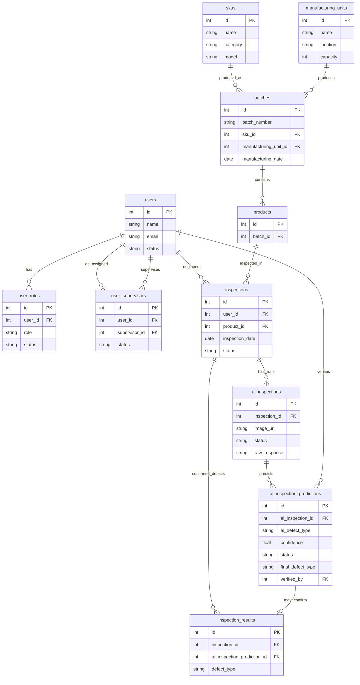

# Quality Inspection

**AI Production Quality Assistant** — a system that helps manufacturing teams track production batches and quality inspections.

## Structure

```
quality-inspection/
├── frontend/               # React frontend (Vite)
│   └── src/
│       ├── app/            # Route table
│       ├── auth/           # Login + route guards
│       ├── layout/         # App shell / nav
│       ├── shared/         # API helper + shared styles
│       └── features/       # Feature folders (admin, supervisor, user, sku, inspection, …)
├── backend/
│   ├── prisma/             # Prisma schema, migrations, seed
│   └── src/
│       ├── app.js          # Express app configuration
│       ├── server.js       # Entry point (listens on port)
│       ├── config/         # Environment + Prisma client
│       ├── constants/      # Shared enums
│       ├── middlewares/    # Auth, validation, errors
│       ├── modules/        # Feature modules (user, product, inspection, …)
│       ├── routes/         # Aggregates module routers under /api
│       └── utils/          # ApiError, uploads, helpers
├── scripts/                # DB setup helpers
└── package.json            # Root scripts
```

Each feature under `backend/src/modules/<entity>/` keeps its route, controller, service, repository, validation, and serializer together. AI inspection code lives under `modules/inspection/` (aiInspection, aiInspectionPrediction, inspectionResult). Frontend screens live under `frontend/src/features/<entity>/`.

## Prerequisites

- Node.js 20+
- [Postgres.app](https://postgresapp.com/) (or any local PostgreSQL)

## Setup

```bash
# Install dependencies
npm run install:all

# Start Postgres.app, then create DB + apply Prisma migrations + seed
npm run db:up
```

Prisma commands (from `backend/`):

```bash
npm run prisma:migrate   # create/apply migrations in dev
npm run migrate          # deploy migrations + seed
npm run prisma:seed      # seed only
```

Schema source of truth: `backend/prisma/schema.prisma`.

`backend/.env` (Postgres.app default — your macOS username, no password):

```
DATABASE_URL=postgresql://YOUR_MAC_USERNAME@127.0.0.1:5432/quality_inspection
PORT=4000
CLIENT_ORIGIN=http://localhost:5173
GOOGLE_AI_API_KEY=googleAPIKey
```

## Develop

```bash
# API on :4000 and Vite on :5173 (proxied /api)
npm run dev
```

Open [http://localhost:5173](http://localhost:5173).

```bash
npm test                   # backend domain/utils/middleware unit tests + frontend Vitest
npm run test --prefix backend
```

## Schema diagram

Core tables and relationships (audit `created_by` / `updated_by` FKs omitted for clarity):



## Entities

### USER

| Field                   | Type                                  |
| ----------------------- | ------------------------------------- |
| id                      | serial                                |
| name                    | string                                |
| email                   | string (unique)                       |
| status                  | enum: `active`, `inactive`, `invited` |
| created_at / updated_at | timestamptz                           |
| created_by / updated_by | FK → users (nullable)                 |

### USER_ROLE

| Field                   | Type                                   |
| ----------------------- | -------------------------------------- |
| id                      | serial                                 |
| user_id                 | FK → users                             |
| role                    | enum: `quality_engineer`, `supervisor` |
| status                  | enum: `active`, `inactive`             |
| created_at / updated_at | timestamptz                            |
| created_by / updated_by | FK → users (nullable)                  |

### USER_SUPERVISOR

| Field                   | Type                                  |
| ----------------------- | ------------------------------------- |
| id                      | serial                                |
| user_id                 | FK → users (quality engineer, unique) |
| supervisor_id           | FK → users (supervisor)               |
| status                  | enum: `active`, `inactive`            |
| created_at / updated_at | timestamptz                           |
| created_by / updated_by | FK → users (nullable)                 |

Many quality engineers map to one supervisor (`user_id` is unique). Creating a **quality engineer** requires `supervisor_id` and inserts `user_roles` + `user_supervisors` in the same transaction.

### SKU

Catalog item produced on the floor. Category + model must be unique.

| Field                   | Type                                                     |
| ----------------------- | -------------------------------------------------------- |
| id                      | serial                                                   |
| name                    | string                                                   |
| category                | enum: `electronics`, `mechanical`, `consumable`, `other` |
| model                   | string                                                   |
| created_at / updated_at | timestamptz                                              |
| created_by / updated_by | FK → users (nullable)                                    |

### MANUFACTURING_UNIT

Physical plant/line that produces batches. `capacity` is how many products are created per batch generate.

| Field                   | Type                  |
| ----------------------- | --------------------- |
| id                      | serial                |
| name                    | string                |
| location                | string                |
| capacity                | integer (≥ 1)         |
| created_at / updated_at | timestamptz           |
| created_by / updated_by | FK → users (nullable) |

### BATCH

One production run of a SKU at a manufacturing unit. Created when an admin generates products; `batch_number` is unique.

| Field                   | Type                     |
| ----------------------- | ------------------------ |
| id                      | serial                   |
| batch_number            | string (unique)          |
| manufacturing_unit_id   | FK → manufacturing_units |
| sku_id                  | FK → skus                |
| manufacturing_date      | date                     |
| created_at / updated_at | timestamptz              |
| created_by / updated_by | FK → users (nullable)    |

### PRODUCT

Individual unit from a batch.

| Field                   | Type                          |
| ----------------------- | ----------------------------- |
| id                      | serial                        |
| batch_id                | FK → batches (cascade delete) |
| created_at / updated_at | timestamptz                   |
| created_by / updated_by | FK → users (nullable)         |

**Generate flow:** admin picks SKU + manufacturing unit → API creates one `batch` with a unique `batch_number` and inserts `capacity` `product` rows in a single transaction. UI shows a message like `Generating <capacity> <skuName> with a unique batch Id.`

Seed data resets the DB and loads 5 car-part SKUs (brake pads, oil filter, headlight, air filter, alloy wheel) and 5 manufacturing units in India (Pune, Chennai, Gurugram, Sanand, Bengaluru) with capacities 1–5, then creates batches/products for a random set of SKU × manufacturing-unit pairs (each batch gets `capacity` products).

### INSPECTION

QE session against one product.

| Field                   | Type                            |
| ----------------------- | ------------------------------- |
| id                      | serial                          |
| user_id                 | FK → users (quality engineer)   |
| product_id              | FK → products                   |
| inspection_date         | date                            |
| status                  | enum: `pending`, `pass`, `fail` |
| created_at / updated_at | timestamptz                     |
| created_by / updated_by | FK → users (nullable)           |

### AI_INSPECTION

Photo upload + vision run for an inspection. Images are stored under `backend/uploads/inspections/`.

| Field                   | Type                                                              |
| ----------------------- | ----------------------------------------------------------------- |
| id                      | serial                                                            |
| inspection_id           | FK → inspections                                                  |
| image_url               | string (local `/uploads/...` path)                                |
| status                  | enum: `processing`, `awaiting_verification`, `completed`, `error` |
| raw_response            | JSON (Gemini / mock payload)                                      |
| created_at / updated_at | timestamptz                                                       |
| created_by / updated_by | FK → users (nullable)                                             |

### AI_INSPECTION_PREDICTION

Normalized AI prediction shown to the engineer before save. One AI run can return **multiple** predictions (e.g. dent + scratch); each is verified independently (approve or override, including to `no_defect`). Defect types are constrained to `scratch`, `dent`, `paint_issue`, `missing_component`, `no_defect`. Unsupported model text is normalized (fallback `no_defect`). `confidence` is a decimal `0–1` requested from the model.

| Field                     | Type                                      |
| ------------------------- | ----------------------------------------- |
| id                        | serial                                    |
| ai_inspection_id          | FK → ai_inspections                       |
| ai_defect_type            | defect enum                               |
| confidence                | decimal(5,4)                              |
| status                    | enum: `pending`, `approved`, `overridden` |
| final_defect_type         | defect enum (set on verify)               |
| comment                   | text (nullable)                           |
| verified_by / verified_at | FK → users / timestamptz                  |
| created_at / updated_at   | timestamptz                               |
| created_by / updated_by   | FK → users (nullable)                     |

### INSPECTION_RESULT

Confirmed defect only (no row when final is `no_defect`). Created when a prediction is approved or overridden to a physical defect. After all predictions for the inspection are decided: **fail** if any result exists, else **pass**.

| Field                       | Type                          |
| --------------------------- | ----------------------------- |
| id                          | serial                        |
| inspection_id               | FK → inspections              |
| ai_inspection_prediction_id | FK → predictions (unique)     |
| defect_type                 | defect enum (not `no_defect`) |
| created_at / updated_at     | timestamptz                   |
| created_by / updated_by     | FK → users (nullable)         |

**QE flow:** start inspection → upload photo → AI prediction shown → accept or override (+ comment) → save. Starting an inspection for the same product + QE reuses the latest existing inspection when one already exists.

Set `GOOGLE_AI_API_KEY` in `backend/.env` for real Google Gemini vision calls (replace the `googleAPIKey` placeholder). Optional: `GOOGLE_VISION_MODEL` (default `gemini-3.8-flash`). The placeholder value is ignored. Without a real key (or with `MOCK_VISION=true`) the API returns mock dent/scratch predictions so local UI still works.

### Sign in

On `/`, choose a **role**, then (for supervisor / quality engineer) a **user**, then **Login**. Admin does not pick a user.

### Admin UI

After signing in as **Admin**:

| Tab                | Route                  | Actions                                                                           |
| ------------------ | ---------------------- | --------------------------------------------------------------------------------- |
| Dashboard          | `/admin/dashboard`     | Org-wide product quality + AI verification KPIs and defect breakdown (no filters) |
| Inspections        | `/admin/inspections`   | All logged inspections (paginated; no filters)                                    |
| Users              | `/users`               | Search + add user                                                                 |
| SKU                | `/skus`                | List + add SKU form                                                               |
| Manufacturing Unit | `/manufacturing-units` | List + add unit form                                                              |
| Products           | `/products`            | List + generate (select SKU + unit)                                               |

### Quality engineer UI

After signing in as **Quality Engineer**:

| Tab               | Route                        | Actions                                                                       |
| ----------------- | ---------------------------- | ----------------------------------------------------------------------------- |
| Dashboard         | `/inspections/dashboard`     | Your product quality + AI verification KPIs and defect breakdown (no filters) |
| Start inspection  | `/inspections`               | Pick SKU/unit/batch/product, then open detail page                            |
| View inspections  | `/inspections/view`          | List previous inspections                                                     |
| Inspection detail | `/inspections/:inspectionId` | Upload photo, verify AI, view results                                         |

### Supervisor UI

After signing in as **Supervisor** (team-scoped to QEs reporting to that supervisor):

| Tab              | Route                     | Actions                                                                                                                                                                                                   |
| ---------------- | ------------------------- | --------------------------------------------------------------------------------------------------------------------------------------------------------------------------------------------------------- |
| Dashboard        | `/supervisor/dashboard`   | Products inspected, predictions, defect rate, AI acceptance, defect table; filter by SKU and batch (Reset clears filters). Clicking a defect-type row opens Team inspections with that filter.            |
| Team inspections | `/supervisor/inspections` | Columns: Inspection, Product, SKU, Status, Total defects, Quality engineer, Timestamp; filter by SKU, defect type, inspector (Reset available). Supports `?defect_type=` / `?sku_id=` from the dashboard. |

## Pre-commit checks

A Husky **pre-commit** hook runs automatically before every commit:

1. **Format** — `prettier --write` (auto-formats, then re-stages changes)
2. **Lint** — `oxlint` (frontend + backend)
3. **Unit tests** — backend domain/utils/middleware tests (Node test runner) + Vitest (frontend)
4. **Security audit** — `npm audit` (root, backend, frontend; fails on high+)

```bash
npm run precommit
```

## API

List `GET`s accept `page` / `limit` (default 20, max 100). Starting an inspection (`user_id`), uploading a photo (`created_by`), and verifying a prediction (`verified_by`) require an active quality engineer.

| Method     | Path                                                    | Description                                                                                             |
| ---------- | ------------------------------------------------------- | ------------------------------------------------------------------------------------------------------- |
| `GET`      | `/api/health`                                           | Health + DB check                                                                                       |
| `GET/POST` | `/api/users`                                            | List (`?q=`, optional `role=`) / create user+role                                                       |
| `GET/POST` | `/api/skus`                                             | List / create SKU                                                                                       |
| `GET/POST` | `/api/manufacturing-units`                              | List / create manufacturing unit                                                                        |
| `GET`      | `/api/products`                                         | List products (includes batch / SKU / unit info)                                                        |
| `POST`     | `/api/products/generate`                                | Body: `sku_id`, `manufacturing_unit_id` → batch + N products                                            |
| `GET/POST` | `/api/inspections`                                      | List (`?user_id=`) / start inspection (reuses latest for same product+QE when present)                  |
| `GET`      | `/api/inspections/supervised`                           | Team inspections for a supervisor (`?supervisor_id=`, optional `defect_type`, `inspector_id`, `sku_id`) |
| `GET`      | `/api/inspections/supervised/summary`                   | Supervisor dashboard KPIs (`?supervisor_id=`, optional `sku_id`, `batch_id`)                            |
| `GET`      | `/api/inspections/overview`                             | All logged inspections (admin; paginated)                                                               |
| `GET`      | `/api/inspections/overview/summary`                     | Org-wide dashboard KPIs (admin)                                                                         |
| `GET`      | `/api/inspections/mine/summary`                         | Signed-in QE dashboard KPIs (`?user_id=`)                                                               |
| `GET`      | `/api/inspections/:id`                                  | Inspection detail                                                                                       |
| `POST`     | `/api/inspections/:id/ai-inspections`                   | multipart `image` + `created_by` → local save + async vision (202)                                      |
| `POST`     | `/api/inspections/:id/predictions/:predictionId/verify` | approve / override prediction (`verified_by` required)                                                  |

## Decisions

1. Used gemini-3.8-flash model for image analysis

## Limitations

1. Multiple AI suggestions for one product is not possible.
2. User authentication is not added.
3.
